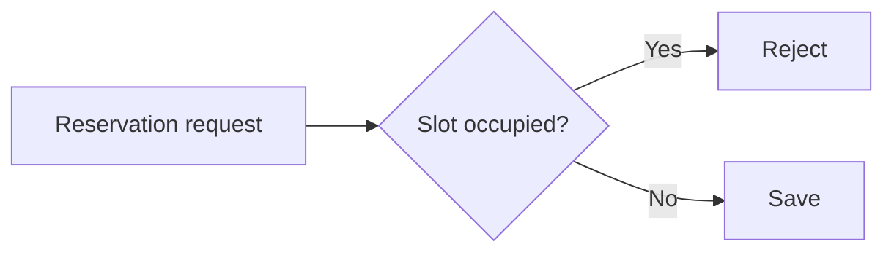

# Plan (03)

Plan outcomes, files, tests and constraints; delegate routine implementation judgment. The orchestrator supplies the isolated worktree; return the plan before implementation. Do not invoke delivery skills from this phase.

Use a trusted direct owner request for assigned work or the matching approved milestone brief for delegated slices. Record the source on GitHub when work must survive the session; silence, labels and bot summaries grant nothing. Have the host invoke `milestone` separately only for missing milestone direction. Preserve lane authorization through temporary blockers; `lane:owner` means owner participation is required.

## 1. Read

Read the issue, its acceptance criteria, scope packet (its ```` ```scope ```` block of paths the work may touch), parent and linked decisions; then the code, tests and agent rules it touches. When a `## Plan` comment exists, read it and the branch to find where work stopped.

**Exit gate:** each acceptance criterion maps to code and tests you have read.

## 2. Draft

- Name outcomes and files within the scope packet, tests and observable assertions per criterion, focused commands, constraints and material risks.
- Specify actual shared interface contracts: inputs, outputs, errors and compatibility obligations. Do not enumerate every signature or prescribe a judgment-free executor. Delegate routine choices to implementation.
- Reserve product/strategy reversal, new paid services or budget increases, and authority/credential/release/quality-gate weakening for the owner. New interactions require owner prototype direction. Independently adjudicate other technical choices and ADRs.
- Bound investigations by question, time limit and evidence exit. A substantive contradiction with intent, contracts or constraints requires replanning; routine discoveries do not. Propose out-of-intent work separately and continue approved independent work.
- If independent adjudication is needed, return a bounded request to the orchestrator with the repository and issue, question and options, recommendation with evidence, applicable issue/rules/contracts/code/constraints, investigation bound, dependencies, and any reserved owner question. Do not dispatch or write another worker's brief. The orchestrator decides whether to assign a fresh leaf worker and fills the complete brief in `milestone`. Re-read the saved decision before continuing.
- Plan merge after the independent GitHub approval gate, then automatic test-environment delivery, with production credentials behind native promotion controls. Require exact owner approval for the production action and artifact; milestone approval never substitutes. Schedule bounded health after production acceptance; unfinished required migrations remain next-product prerequisites.

**Exit gate:** outcomes map to files, tests, contracts and constraints; reserved decisions are resolved or visibly blocked with options and a recommendation.

## 3. Approve and post

- Show the draft; wait only on reserved owner decisions, continuing independent approved work. Routine plans within recorded authority need no new approval.
- Post it as one issue comment headed `## Plan` only in `lane:afk` or when the work may outlive the session.
- When resuming or departing from it, edit that comment in place by its id (`gh api -X PATCH`). Never `gh issue comment --edit-last`; it may hit another session's comment.
- Use the envelope below: executive summary ≤ 3 sentences; scope, risks and decision one line each. Keep material risks, blockers and owner choices visible; include options and a recommendation when a decision is needed. Collapse steps and evidence with `<details>` / `<summary>`, blank lines around Markdown inside. Use no CSS or scripts. Add fenced `mermaid` with a text explanation only when a diagram clarifies a flow or relationship; omit empty sections.

````markdown
## Plan

### Executive summary
Reject duplicate reservations before saving; keep the existing API response.

**Scope:** reservation service and its unit tests.
**Risks:** concurrent requests need a separate transaction fix.
**Decision:** Craftsman implements the approved slice; concurrency stays out of scope.

<details>
<summary>Change flow</summary>

Check the slot before saving; reject an occupied slot.



</details>

<details>
<summary>Implementation steps</summary>

1. In `src/reservations/service.py`, reject an occupied slot; preserve the existing API error contract. Add `test_duplicate_is_rejected` in `tests/reservations/test_service.py`: the second call fails and only one reservation persists. Verify with `pytest tests/reservations/test_service.py`.

</details>

<details>
<summary>Verification and acceptance evidence</summary>

| Criterion | Test and command |
| --- | --- |
| Duplicate rejected | `test_duplicate_is_rejected`; `pytest tests/reservations/test_service.py` |

</details>
````

**Exit gate:** an executable plan under established authority, with its `## Plan` link when durable; reserved decisions remain visibly blocked. A routine plan cannot authorize work beyond the recorded owner request or milestone brief.

## Output

≤ 5 lines. **Summary:** step count, and the comment link when posted. **Decision:** the plan to approve when it takes an owner decision, or why the issue went back and its question, with a recommendation, or the next action and responsible actor. Use "Nothing needed" only with no pending action.
